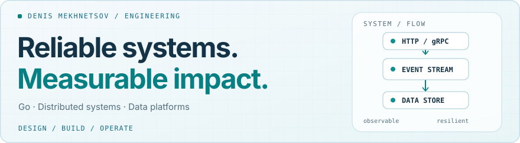
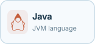
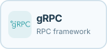
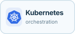
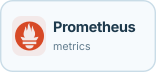
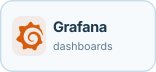
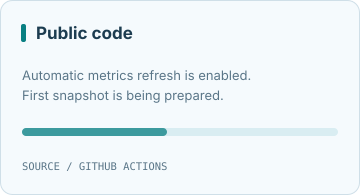

  <picture>
    <source media="(prefers-color-scheme: dark)" srcset="./assets/header-dark.svg">
    
  </picture>

**Backend Engineer · Go / Kotlin / Java**

Production engineering experience at **T-Bank** · Computer Science at **HSE University**

[**Featured projects**](#featured-projects) · [**Engineering stack**](#engineering-stack) · [**Telegram**](https://t.me/DenisMekhnetsov)

---

## About

I build backend services that are **predictable, observable, and maintainable**. I care about clear contracts, data correctness, failure handling, and making performance improvements measurable.

Previously, I worked on production backend systems and internal developer tooling at **T-Bank**. My work involved service integrations, background processing, data pipelines, release workflows, and operational reliability.

My primary interests are **Go, distributed systems, data-intensive applications, performance engineering**, and developer infrastructure.

> Much of my T-Bank work is proprietary. The projects below are public examples of how I approach engineering, not copies of internal systems.

## Featured projects

| Project | What is worth exploring |
| :--- | :--- |
| **[Lotty — A/B testing platform](https://github.com/DenisMekh/Lotty-A-B-testing-platform)**  Go · PostgreSQL · Gin · Prometheus · Grafana | Deterministic assignment, experiment lifecycle, event attribution, and automated guardrails. Includes [C4 architecture](https://github.com/DenisMekh/Lotty-A-B-testing-platform/tree/main/docs/architecture), [ADRs](https://github.com/DenisMekh/Lotty-A-B-testing-platform/tree/main/docs/adr), [runbook](https://github.com/DenisMekh/Lotty-A-B-testing-platform/blob/main/docs/runbook.md), and reproducible demos. |
| **[BrandRadar — Brand monitoring](https://github.com/DenisMekh/BrandRadar)**  Go · PostgreSQL · Redis · React · Python/FastAPI | Ingestion from web, RSS, and Telegram; deduplication, ML-assisted classification, anomaly detection, alerts, and observability. Explore the [source](https://github.com/DenisMekh/BrandRadar) and [backend documentation](https://github.com/DenisMekh/BrandRadar/blob/main/backend/README.md). |

**What I optimize for:** clear boundaries between services, testable behavior, practical observability, and documentation that lets another engineer reproduce the system.

## Engineering stack

I work primarily on backend services and data systems. These are technologies I've used in professional or public-project work, grouped by purpose rather than proficiency.

**Languages & APIs**

  <picture>
    <source media="(prefers-color-scheme: dark)" srcset="./assets/stack/go-dark.svg">
    
  </picture>
  <picture>
    <source media="(prefers-color-scheme: dark)" srcset="./assets/stack/kotlin-dark.svg">
    
  </picture>
  <picture>
    <source media="(prefers-color-scheme: dark)" srcset="./assets/stack/java-dark.svg">
    
  </picture>
  <picture>
    <source media="(prefers-color-scheme: dark)" srcset="./assets/stack/grpc-dark.svg">
    
  </picture>

**Data & messaging**

  <picture>
    <source media="(prefers-color-scheme: dark)" srcset="./assets/stack/postgresql-dark.svg">
    
  </picture>
  <picture>
    <source media="(prefers-color-scheme: dark)" srcset="./assets/stack/clickhouse-dark.svg">
    
  </picture>
  <picture>
    <source media="(prefers-color-scheme: dark)" srcset="./assets/stack/redis-dark.svg">
    
  </picture>
  <picture>
    <source media="(prefers-color-scheme: dark)" srcset="./assets/stack/kafka-dark.svg">
    
  </picture>

**Infrastructure & observability**

  <picture>
    <source media="(prefers-color-scheme: dark)" srcset="./assets/stack/docker-dark.svg">
    
  </picture>
  <picture>
    <source media="(prefers-color-scheme: dark)" srcset="./assets/stack/kubernetes-dark.svg">
    
  </picture>
  <picture>
    <source media="(prefers-color-scheme: dark)" srcset="./assets/stack/prometheus-dark.svg">
    
  </picture>
  <picture>
    <source media="(prefers-color-scheme: dark)" srcset="./assets/stack/grafana-dark.svg">
    
  </picture>

Also part of my workflow: REST/HTTP, Git, Linux, and CI/CD. Icons are embedded locally; see [asset credits](assets/stack/ICON-LICENSES.md).

### Engineering radar

| Use | Build | Explore |
| :--- | :--- | :--- |
| Go, JVM, PostgreSQL, Kafka | Services, pipelines, internal tooling | AI-assisted developer workflows |
| Docker, Kubernetes, monitoring | Experimentation and observability | Agent integrations and automation |

## GitHub activity

  <picture>
    <source media="(prefers-color-scheme: dark)" srcset="./profile/stats-dark.svg">
    
  </picture>
  <picture>
    <source media="(prefers-color-scheme: dark)" srcset="./profile/languages-dark.svg">
    
  </picture>

Cards are generated daily by GitHub Actions. Language percentages reflect repository code, not proficiency; proprietary work is not represented in public-language statistics.

<strong>A year of contributions — animated</strong>

  <picture>
    <source media="(prefers-color-scheme: dark)" srcset="https://raw.githubusercontent.com/DenisMekh/DenisMekh/output/github-snake-dark.svg">
    
  </picture>

Generated by [snk](https://github.com/Platane/snk) using the existing [snake workflow](https://github.com/DenisMekh/DenisMekh/blob/main/.github/workflows/snake.yml).

## Education & contact

**HSE University** — Faculty of Computer Science.

Interested in discussing **Go / Backend Engineering**, distributed systems, or a project? Reach me on **[Telegram](https://t.me/DenisMekhnetsov)**.
